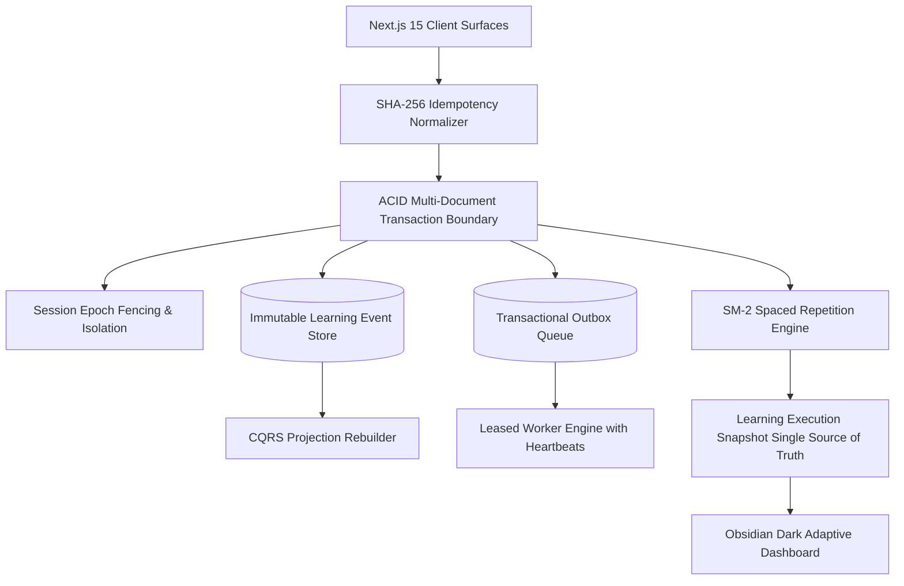

# DSA Club — Autonomous Adaptive Learning Operating System

[](https://www.typescriptlang.org/)
[](https://nextjs.org/)
[](https://react.dev/)
[](https://www.mongodb.com/)
[](https://vitest.dev/)
[](LICENSE)

**DSA Club** is an enterprise-grade, evidence-grounded **DSA Learning Operating System** designed to eliminate the #1 reason candidates fail technical interviews: **decision fatigue and lack of retention continuity**.

Unlike conventional problem databases or basic LeetCode clones, DSA Club operates as an autonomous algorithmic coach. It formulates deterministic multi-week preparation blueprints, tracks authentic mastery via hint-penalty attribution, and automatically schedules spaced repetition reviews (SM-2) right before memory decay occurs.

---

## 🏗️ System Architecture & Engineering Highlights



### Key Engineering Invariants

1. **ACID Multi-Document Transactions**:
   Practice submissions, review executions, interview drills, and day advancement commit atomically within MongoDB replica set transactions (`ClientSession`).
2. **Distributed Idempotency (The Stripe Pattern)**:
   Command payloads are deterministically normalized and hashed with SHA-256. Duplicate requests from network retries or multi-clicks instantly return cached authoritative receipts without double-advancing plans or duplicating XP.
3. **Session Epoch Fencing**:
   Practice sessions are bound to an immutable `learningEpoch`. Data wipes or major session boundaries increment the epoch, immediately rejecting stale requests or disconnected browser tabs with deterministic HTTP 409 conflicts.
4. **Transactional Outbox & Worker Leases**:
   Decouples user write paths from heavy downstream notifications and projections. Background workers claim tasks using atomic `findOneAndUpdate` with lease tokens and heartbeat timestamps to recover from worker crashes.
5. **Command-Query Separation (CQS) & Single Source of Truth**:
   All UI surfaces (Dashboard, Intelligence Plan, Practice Workspace) consume a single server-projected `LearningExecutionSnapshot`. Dashboard loading is a strictly idempotent read operation with zero database mutations.
6. **Cognitive Spaced Repetition (Enhanced SM-2)**:
   Calculates review intervals using review grades (0 to 5) and confidence scores. Enforces Grade 0 failure invariance (instant interval reset) and penalizes hint-assisted solves to prevent false mastery.
7. **Query Waterfall & N+1 Query Elimination**:
   Eliminates sequential loop queries by batching topic lookups using `$in` filters and parallelizing independent database reads via `Promise.all`.

---

## 💻 Tech Stack

- **Framework**: [Next.js 15 (App Router)](https://nextjs.org/) + [React 19](https://react.dev/)
- **Language**: [TypeScript](https://www.typescriptlang.org/) (Strict mode, zero `any` compromises)
- **Database**: [MongoDB](https://www.mongodb.com/) via [Mongoose 8](https://mongoosejs.com/) with Replica Set transaction support
- **Authentication**: [NextAuth v5 (Auth.js)](https://authjs.dev/) with Edge JWT validation & RBAC
- **Styling & Motion**: [Tailwind CSS v4](https://tailwindcss.com/) & [Framer Motion](https://www.framer.com/motion/) (Obsidian Dark Design System)
- **Testing**: [Vitest](https://vitest.dev/) + [MongoMemoryReplSet](https://github.com/nodkz/mongodb-memory-server) (850+ unit and integration tests)

---

## 📁 Repository Structure

```text
src/
├── app/                  # Next.js 15 App Router pages, server layouts & API routes
│   ├── (auth)/           # Authentication flows (login, register, reset)
│   ├── (product)/        # Authenticated workspace (dashboard, intelligence, practice, learn)
│   └── api/              # Secure API webhooks & cron worker endpoints
├── components/           # UI Components & design system tokens
│   ├── layout/           # Sidebar, navbar, mobile drawer, responsive wrappers
│   ├── product/          # Workspace editors, problem cards, stats, consistency widgets
│   └── ui/               # Reusable obsidian glassmorphic primitives (Card, Button, Badge)
├── config/               # Canonical navigation architecture & route audits
├── features/             # Domain-Driven Feature Modules
│   ├── intelligence/     # Canonical planner, decision policies, execution snapshot, event store
│   ├── learning/         # Practice sessions, command handlers, ACID transactions
│   ├── revision/         # Spaced repetition engine (SM-2 retention algorithm)
│   ├── learning-paths/   # Curated curriculums (Blind 75, NeetCode 150, SDE Sheet)
│   ├── content/          # Problem taxonomy, algorithmic pattern mental models
│   ├── product/          # Dashboard analytics, streak calculator, gamification XP
│   └── auth/             # Session resolvers, password hashing, role authorizers
└── lib/                  # Database connections, crypto utils, client serializers
```

---

## 🚀 Getting Started

### Prerequisites

- **Node.js**: `v20.x` or higher
- **MongoDB**: MongoDB 6.0+ (Replica Set enabled for local transactions) or MongoDB Atlas

### 1. Clone & Install Dependencies

```bash
git clone https://github.com/your-username/dsa-club.git
cd dsa-club
npm install
```

### 2. Environment Variables

Create `.env.local` in the project root:

```env
MONGODB_URI=mongodb+srv://<username>:<password>@cluster.mongodb.net/dsa-club?retryWrites=true&w=majority
AUTH_SECRET=your_super_secret_auth_key_here
NEXTAUTH_URL=http://localhost:3000
CRON_SECRET=your_cron_worker_secret_here

# Optional: Studio media storage
CLOUDINARY_CLOUD_NAME=your_cloud_name
CLOUDINARY_API_KEY=your_api_key
CLOUDINARY_API_SECRET=your_api_secret
```

### 3. Initialize Database Indexes & Seed

```bash
npm run db:indexes
```

### 4. Run Development Server

```bash
npm run dev
```

Open [http://localhost:3000](http://localhost:3000) in your browser.

---

## 🧪 Testing Suite & Quality Verification

DSA Club is protected by **850+ automated unit, integration, and architecture tests** running against live in-memory replica sets:

```bash
# Run full Vitest suite (850+ tests across 77+ suites)
npm test

# Run TypeScript strict type-check
npm run typecheck

# Run Navigation & Route Audit
npx vitest run src/config/routes-audit.test.ts src/config/navigation.config.test.ts

# Run Real Acceptance Journeys A–O
npx vitest run src/features/learning/services/phase9-continuity-verification.test.ts
```

---

## 📄 License

This project is licensed under the MIT License — see the [LICENSE](LICENSE) file for details.
