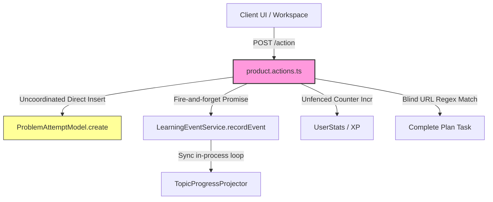
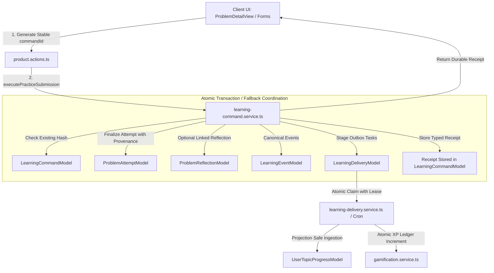

# Phase 1: Foundation and Reliability Specification & Architecture

This document specifies the architecture, source-of-truth ownership, transaction boundaries, idempotent learning commands, delivery outbox, session persistence, and recovery mechanics implemented for **Phase 1: Foundation and Reliability** in DSA Club.

---

## 1. Before vs. After Write Flow

### Legacy (Before Phase 1)

- **Flaws:**
  - Duplicate submissions from browser retries or network double-posts generated duplicate attempts and double XP.
  - Failures in projector or stats increment left orphaned records or permanently missed progress updates.
  - Zero-timer stops fell back to arbitrary 15-minute fake study records.
  - Grade 0 in revision defaulted to Grade 3 via `grade || 3`.
  - Hint state could be lowered or wiped by the client without audit trail.
  - Reset actions deleted partial collections, allowing old completed tasks to resurrect on subsequent visits.

### Architecture (Phase 1)


---

## 2. Source-of-Truth Ownership

| Domain Entity | Authoritative Model | Secondary / Derived Projections | Invalidation / Reconciliation Rule |
| :--- | :--- | :--- | :--- |
| **Practice Attempt** | `ProblemAttemptModel` | `UserTopicProgressModel`, `UserActivityDayModel` | Immutable once committed. Attempt belongs to a single `sessionId` and `learningEpoch`. |
| **Practice Session** | `PracticeSessionModel` | UI Workspace State | Authoritative for active draft, accumulated timer, and scoped hint/editorial assistance. |
| **Submission Command** | `LearningCommandModel` | Typed `LearningReceipt` | Deduplicates identical submissions via SHA-256 semantic payload hash. |
| **Review Schedule** | `RevisionQueueModel` | `RevisionHistoryModel` | Authoritative for next due date and SM-2 interval; Grade 0 strictly preserved. |
| **Downstream Outbox** | `LearningDeliveryModel` | Async workers, notification dispatchers | Workers claim batches using atomic find-and-modify with expiration leases. |
| **Learner Epoch** | `UserModel.learningEpoch` | All 25 learning collections | Fencing key: any operation or worker carrying `epoch < currentEpoch` is rejected. |

---

## 3. Transaction Boundaries & Concurrency

### Practice Submission Boundary
Persisted inside a single MongoDB transactional session (falling back to atomic coordinated sequencing when running on standalone non-replica sets):
1. **Idempotency Guard**: Query `LearningCommandModel` for `{ userId, learningEpoch, commandId }`.
   - If found and payload SHA-256 matches: return stored receipt immediately (no-op).
   - If found and payload SHA-256 differs: throw `409 Conflict`.
2. **Attempt Finalization**: Finalize `ProblemAttemptModel` with validated duration provenance (`measured`, `reported`, or `unknown`) and attempt-scoped assistance flags (`hintsRevealedLevels`, `editorialViewed`, `aiAssisted`).
3. **Canonical Event Emission**: Write `problem_solved` / `problem_attempted` to `LearningEventModel`.
4. **Plan Task Reconciliation**: If an authentic plan task match is found on the active day, mark task complete.
5. **Durable Outbox Staging**: Create pending `LearningDeliveryModel` tasks for `topic_progress_projection` and `gamification_xp`.
6. **Receipt Commitment**: Commit `LearningCommandModel` with status `"committed"` and full `LearningReceipt`.

### Transaction Rules
- Parallel operations on the same session are forbidden (Mongoose constraint).
- No external HTTP calls, cache invalidation, or socket emits occur inside the transaction.
- Stable logical IDs (`attemptId`, `receiptId`, `eventId`) are generated before the transaction executes to survive callback retries.

---

## 4. Command & Receipt Semantics

### Command Identification
- Commands carry a UUIDv4 `commandId` generated on the client before network transmission.
- The `commandId` survives user retries, transient network failures, and browser reloads.
- Payload normalization produces a deterministic SHA-256 hash.

### Typed Receipt Contract
```typescript
interface LearningReceipt {
  commandId: string;
  commandKind: "practice_submission" | "review_submission";
  status: "committed" | "conflict";
  learningEpoch: number;
  commitTimestamp: string;
  attemptId?: string;
  sessionId?: string;
  reviewAttemptId?: string;
  planEffect: {
    status: "completed" | "already_completed" | "not_applicable" | "stale_context";
    planId?: string;
    dayNumber?: number;
    taskId?: string;
  };
  downstreamStatus: "applied" | "staged_in_outbox" | "failed";
  provenance: {
    durationProvenance: "measured" | "reported" | "unknown";
    durationMinutes: number;
    isAssisted: boolean;
    hasPriorExposure: boolean;
  };
}
```

---

## 5. Session & Attempt Identity Scoping

### Practice Session Lifecycle
1. **Resume or Create**: `getOrCreatePracticeSession` inspects `PracticeSessionModel` for `{ userId, learningEpoch, problemId, state: { $in: ["active", "paused"] } }`.
2. **Hint Ladder Revealing**: `recordAttemptHintReveal` appends hint levels monotonically to the active session. If hint `N` is already revealed, it is deduplicated.
3. **Fresh Attempt**: `startFreshAttempt` finalizes or discards current attempt state, increments `activeAttemptNumber`, resets `hintsRevealedLevels = []`, `editorialViewed = false`, and `aiAssisted = false`, while setting `hasPriorExposure = true`.
4. **Assistance Boundary**: Assistance in attempt $K$ classifies attempt $K$ as assisted, but does **not** permanently taint attempt $K+1$.

---

## 6. Duration Provenance & Honest Accounting

We strictly separate measured active effort from unverified estimates:
- **`measured`**: Timer actively run on page (`measuredDurationSeconds > 0`). Recorded as whole minutes rounded up (`Math.ceil(s / 60)`).
- **`reported`**: Explicit learner input via submission form without active stopwatch.
- **`unknown`**: Timer was never started or is 0, and user did not self-report. **Never falls back to 15 or 20 minutes.**
- **Recommendation Estimates**: Tasks display content-prescribed estimates. Recommendation algorithms never artificially shorten a problem's estimate to force-fit a user's stated time window.

---

## 7. Concrete Defects Resolved

### Defect A: Zero-Grade Fallback
- Replaced all instances of `grade || 3` with `grade !== undefined ? grade : 3`.
- SM-2 algorithm correctly resets repetition count and interval to 1 day on `grade === 0` (Blackout failure).
- Frontend `RevisionSession` correctly dispatches and highlights grade 0.

### Defect B: Activity Identity Canonicalization
- `activity-aggregator.ts` aggregates distinct attempts by problem ID for unique solve counts, but preserves separate timeline events for repeat attempts and revision reviews.
- Review entries track `reviewAttemptId` to prevent double-counting.

### Defect C: XP Award Integrity
- `GamificationService.awardXP` operates idempotently.
- Uses `statsIncremented` flag to prevent duplicate awards if connection drops between ledger insertion and aggregate counter update.

### Defect D: Safe Plan Reconciliation
- URL regex matching was removed in favor of exact task identification (`planId`, `dayNumber`, `taskId`).
- Only active-day actionable tasks matching the entity can be reconciled. Off-plan learning saves safely with `planEffect.status = "not_applicable"` or `"stale_context"`.

### Defect E: Honest Evidence & Language
- Removed heuristic saturation where reflection length or self-confidence increased transfer mastery scores.
- Replaced misleading labels ("Mastered", "Verified Solve", "100% Ready for Company X") with honest descriptors: "Cycle completed", "Practice coverage", "Retention not yet assessed".

---

## 8. Learning Data Reset Lifecycle

When a learner triggers `resetLearningDataAction("RESET")`:
1. Increments `UserModel.learningEpoch` by 1.
2. Wipes or archives records across all **25 learning collections**:
   - `ProblemAttemptModel`, `PracticeSessionModel`, `LearningCommandModel`, `LearningDeliveryModel`
   - `ProblemReflectionModel`, `LearningEventModel`, `RevisionQueueModel`, `RevisionHistoryModel`
   - `UserTopicProgressModel`, `UserPlanModel`, `DailyPlanModel`, `LearningAssessmentModel`
   - `UserStatsModel`, `UserActivityDayModel`, `UserGamificationActivityModel`, `XpTransactionModel`
   - `RecommendationDismissalModel`, `LearnerPatternPerformanceModel`, `DiagnosticResultModel`
   - `RoadmapPlanModel`, `MilestoneModel`, `MissionDraftModel`, `TopicDraftModel`
3. Epoch fencing guarantees that any async worker or in-flight request started before the reset cannot write old-epoch data to the database.

---

## 9. Durable Outbox & Delivery Worker

### Outbox Model (`LearningDeliveryModel`)
- Fields: `deliveryId`, `userId`, `learningEpoch`, `handler`, `payload`, `status` (`pending`, `claimed`, `completed`, `failed`), `leaseExpiresAt`, `claimedBy`, `attempts`, `error`.
- Handlers:
  - `topic_progress_projection`: Calls `TopicProgressProjector.handleEvent`.
  - `gamification_xp`: Calls `GamificationService.awardXP`.

### Recovery & Cron
- **Local / Worker Execution**: `processDeliveryBatch({ batchSize: 20 })`.
- **API Endpoint**: `POST /api/learning/delivery-worker`.
- **Security**: Requires header `x-cron-secret` matching `CRON_SECRET` in environment. Fails closed (401) if secret is missing or misconfigured.
- **Stale Lease Recovery**: Automatically recovers deliveries claimed by workers that crashed over 5 minutes ago.

---

## 10. Database Indexes & Deployment

The script `scripts/sync-indexes.ts` has been upgraded with pre-flight conflict detection and additive index synchronization:
- Run pre-flight dry run:
  ```bash
  npx tsx scripts/sync-indexes.ts --dry-run
  ```
- Deploy indexes safely:
  ```bash
  npx tsx scripts/sync-indexes.ts
  ```

Key Compound & Unique Indexes:
- `LearningCommandModel`: `{ userId: 1, learningEpoch: 1, commandId: 1 }` (unique)
- `PracticeSessionModel`: `{ userId: 1, learningEpoch: 1, problemId: 1 }` (unique, partial for `active`/`paused`)
- `LearningDeliveryModel`: `{ status: 1, leaseExpiresAt: 1 }`, `{ userId: 1, learningEpoch: 1 }`
- `UserTopicProgressModel`: `{ userId: 1, learningEpoch: 1, topicSlug: 1 }` (unique)
