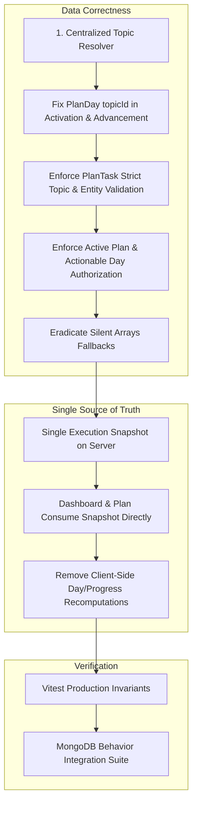

# Implementation Plan — Phase 0: Correctness Gate

**File**: `implementation_plan.md`  
**Date**: September 2026  
**Status**: Completed & Verified (49/49 Vitest Suites, 494 Tests Passing, TypeScript 100% Clean)  
**Scope**: Complete architectural implementation of Phase 0 (Correctness Gate) based on the DSA Club Intelligence Final Product Audit.

---

## 1. Executive Summary & Goals

The product audit determined that **Club Intelligence is not yet a differentiated intelligence product** because correctness contracts are not fully enforced, next actions are duplicated across surfaces, per-day topic identity is corrupted in multi-topic plans, and progress semantics conflate schedule pace with topic mastery.

Before any advanced intelligence features, LLM mentor extensions, or adaptive machine learning policies are developed, **Phase 0 (Correctness Gate)** must establish an airtight deterministic foundation.

### Phase 0 Mandatory Gates:
1. **Fix per-day `topicId` persistence**: In multi-topic plans, ensure `PlanDay.topicId` strictly corresponds to `PlanDay.topicSlug`, resolving each day's topic document from the blueprint rather than inheriting the plan's primary topic. Ensure normal completion and skip completion use this identical resolution logic.
2. **Reject mismatched `PlanTasks`**: Validate that `Task.planId === ActivePlan.id`, `Task.planDayId === CurrentPlanDay.id`, `Task.topicId === CurrentPlanDay.topicId`, and `Task.topicSlug === CurrentPlanDay.topicSlug`. For problem tasks, verify `Problem.topicIds` matches `PlanTask.topicId`. Mismatched tasks must be marked `unavailable`/`mismatched` and excluded from actionable CTAs.
3. **Authorize completion against the active plan**: `completePlanTaskAction` and `skipPlanTaskAction` must verify the task belongs to the user's *currently active plan* and to the *currently actionable plan day*. Stale tasks from archived/completed/paused plans or locked future days must be rejected with explicit authorization errors.
4. **Remove silent `arrays` fallbacks**: Eradicate all `|| "arrays"` and `|| "Arrays"` fallbacks across canonical planner, migration services, actions, and snapshots. Missing topic identity must trigger explicit data-quality warnings or unavailable states, never silent re-labelling.
5. **Make execution snapshot the single source for Dashboard and Plan**: Eliminate parallel/competing queries in `/dashboard` and `/intelligence`. `resolveLearningExecutionSnapshot` becomes the single source of truth for `activePlan`, `currentPlanDay`, `todayTasks`, `primaryTodayAction`, and `semanticProgress`.
6. **Remove duplicate UI-side progress calculations**: Eliminate client-side day-finding (`days.find(...)`), task filtering, and pace/completion arithmetic in `TodayPlanBoard.tsx`, `OverviewTab.tsx`, and `ClubIntelligenceCard.tsx`. Rely entirely on server-projected `SemanticProgressMetrics`.
7. **Add integration tests against real MongoDB behavior** covering:
   - Multi-topic plans
   - Stale task completion
   - Activation races
   - Pause / resume
   - Timezone boundaries
   - Unavailable content
   - Duplicate completion requests

---

## 2. Technical Audit & Root-Cause Analysis

### 2.1 Bug 1: Per-Day `topicId` Persistence Corruption
- **Location**: `src/features/intelligence/services/plan-migration.service.ts` (lines 167 & 300)
  ```typescript
  // IN TRANSACTIONAL & NON-TRANSACTIONAL ACTIVATION PATHS:
  const dayDocs = params.blueprint.estimatedSchedule.slice(0, 7).map((d) => ({
    ...
    topicId: primaryTopicDoc?._id || null, // ❌ BUG: Every day gets the plan's primary topic ID!
    topicSlug: d.topicSlug,
    topicName: d.topicName,
  }));
  ```
- **Location**: `src/features/intelligence/actions/plan-actions.ts` (lines 280-302 & 627-629)
  ```typescript
  // In skipPlanTaskAction:
  nextDay = await PlanDayModel.create({
    ...
    topicId: plan.primaryTopicId, // ❌ BUG: Hardcoded to primaryTopicId on skip!
    topicSlug: nextBlueprintDay.topicSlug || "arrays",
  });
  // In completePlanTaskAction:
  topicId: topicDoc?._id || currentDay.topicId, // ❌ BUG: Falls back to currentDay.topicId if missing
  ```
- **Consequence**: When a plan spans multiple topics (e.g. Days 1–7 Arrays, Days 8–14 Two Pointers), Day 8 has `topicSlug: "two-pointers"` but `topicId` pointing to the MongoDB ObjectId for Arrays. Any progress tracking, query filtering, or topic mastery updates are attributed to the wrong topic.

### 2.2 Bug 2: Missing Validation for Mismatched `PlanTasks`
- **Location**: `src/features/intelligence/services/learning-execution-snapshot.ts` (lines 347-366)
  ```typescript
  const rawTodayTasks = tasks.filter((t) => {
    if (!currentDayId) return false;
    return String(t.planDayId) === currentDayId && String(t.planId) === planIdStr;
  });
  ```
- **Consequence**: Tasks whose `topicId` or `topicSlug` does not match `currentPlanDay` are passed into `todayTasks` without inspection. If a problem entity belongs to a foreign topic, `topicAlignment` defaults to `"aligned"` unless caught earlier. Mismatched tasks can appear as the primary CTA for the day.

### 2.3 Bug 3: Stale Task Completion Authorization Hole
- **Location**: `src/features/intelligence/actions/plan-actions.ts` (lines 167-175 & 543-557)
  ```typescript
  const existingTask = await PlanTaskModel.findOne({
    _id: taskObjectId,
    userId: userObjectId,
  });
  ```
- **Consequence**: Neither `completePlanTaskAction` nor `skipPlanTaskAction` checks `activePlan`. A user with a cached tab or archived plan can submit completion for an archived plan's task, updating old plan days, completing old cycles, or desynchronizing their active plan. Also, tasks on locked future days can be completed out-of-order.

### 2.4 Bug 4: Silent `"arrays"` Fallbacks
- **Locations**:
  - `src/features/intelligence/planning/canonical-planner.ts`: Line 80 (`return firstUnseen ? firstUnseen.slug : "arrays";`)
  - `src/features/intelligence/actions/plan-actions.ts`: Lines 63, 280, 282, 628, 642
  - `src/features/intelligence/services/learning-execution-snapshot.ts`: Lines 363, 364, 435
  - `src/features/intelligence/services/plan-migration.service.ts`: Lines 37, 393
- **Consequence**: Any data gap, malformed input, or unmapped topic slug is silently coerced into `"arrays"`, displaying valid-looking Arrays headers instead of surfacing data-quality issues or unavailable states.

### 2.5 Bug 5 & 6: Duplicate UI-Side Calculations & Split Source of Truth
- **Locations**:
  - `src/app/(product)/intelligence/page.tsx`: Fetches both `resolveLearningExecutionSnapshot` and `resolveUserActivePlan`, re-mapping data independently.
  - `src/components/intelligence/TodayPlanBoard.tsx`: Re-filters tasks with `tasks.filter(t => activeDay && t.planDayId === activeDay.id)` and re-resolves `activeDay`.
  - `src/components/intelligence/OverviewTab.tsx`: Re-computes `cyclePacePercent`, `todayTasksCount`, `todayTaskCompletionPercent`, and `isNotAssessed`.
  - `src/components/product/dashboard/ClubIntelligenceCard.tsx`: Re-computes `cyclePacePercent = activePlan?.cyclePacePercent ?? progressMetrics?.cyclePacePercent ?? Math.min(...)`.
- **Consequence**: Day 1 of a 22-day cycle can display as 5% in one card while showing 0% in another; different tabs can disagree on what the current day or next task is.

---

## 3. Detailed Implementation Plan



---

### Step 1: Centralized Topic Resolver & Per-Day `topicId` Persistence
**Target Files**:
- `src/features/intelligence/services/plan-content-resolver.ts`
- `src/features/intelligence/services/plan-migration.service.ts`
- `src/features/intelligence/actions/plan-actions.ts`

**Changes**:
1. In `plan-content-resolver.ts`:
   - Export helper `resolveTopicDocForSlug(slug: string): Promise<{ _id: Types.ObjectId; slug: string; name: string } | null>` with an in-memory/batch lookup cache.
2. In `plan-migration.service.ts`:
   - In `activateCanonicalPlanForUser` (both transactional `txResult` and non-transactional fallback):
     - Collect unique topic slugs from `blueprint.estimatedSchedule`.
     - Batch fetch topic documents via `TopicModel.find({ slug: { $in: uniqueSlugs } })`.
     - Map each blueprint day `d` to its corresponding `topicDoc`:
       ```typescript
       const topicDoc = topicMap.get(d.topicSlug);
       // Invariant: topicId corresponds strictly to d.topicSlug
       topicId: topicDoc?._id || null,
       topicSlug: d.topicSlug,
       topicName: topicDoc?.name || d.topicName,
       ```
3. In `plan-actions.ts`:
   - Refactor `completePlanTaskAction` and `skipPlanTaskAction` to use `resolveTopicDocForSlug` when materializing `nextDay`:
     ```typescript
     const topicDoc = await resolveTopicDocForSlug(nextBlueprintDay.topicSlug);
     topicId: topicDoc?._id || null, // Never fall back to primaryTopicId or currentDay.topicId!
     topicSlug: nextBlueprintDay.topicSlug,
     topicName: topicDoc?.name || nextBlueprintDay.topicName,
     ```

---

### Step 2: Reject Mismatched `PlanTasks`
**Target Files**:
- `src/features/intelligence/services/learning-execution-snapshot.ts`
- `src/features/intelligence/services/plan-content-resolver.ts`

**Changes**:
1. In `learning-execution-snapshot.ts`:
   - When filtering `todayTasks`, enforce strict metadata matching against `currentPlanDay`:
     ```typescript
     const currentDayTopicIdStr = currentPlanDay.topicId ? String(currentPlanDay.topicId) : null;
     const currentDayTopicSlug = currentPlanDay.topicSlug;

     const validatedTodayTasks = rawTodayTasks.map((t) => {
       const taskTopicIdStr = t.topicId ? String(t.topicId) : null;
       const isTopicMismatched = 
         (taskTopicIdStr && currentDayTopicIdStr && taskTopicIdStr !== currentDayTopicIdStr) ||
         (t.topicSlug && currentDayTopicSlug && t.topicSlug !== currentDayTopicSlug);

       if (isTopicMismatched) {
         return {
           ...t,
           topicAlignment: "mismatched" as const,
           status: "unavailable" as const,
           required: false,
         };
       }
       return t;
     });
     ```
   - In `primaryTodayAction` selection:
     - Disallow tasks with `topicAlignment === "mismatched"` or `status === "unavailable"` from becoming the `primaryTodayAction`.
     - If all tasks are unavailable/mismatched, display an explicit repair/unavailable state with actionable recovery.
2. In `plan-content-resolver.ts`:
   - In `resolvePlanActivity`, verify problem primary topic matches `topicDoc._id`. If mismatched, mark `validationStatus: "mismatched"`, `status: "unavailable"`.

---

### Step 3: Authorize Completion Against Active Plan & Actionable Day
**Target Files**:
- `src/features/intelligence/actions/plan-actions.ts`

**Changes**:
1. In `completePlanTaskAction(taskId, evidence)`:
   - Query user's currently active plan:
     ```typescript
     const activePlan = await PlanModel.findOne({
       userId: userObjectId,
       status: "active",
     });
     if (!activePlan) {
       throw new Error("No active plan found. Please activate or resume your plan.");
     }
     ```
   - Find task and verify plan ownership:
     ```typescript
     const existingTask = await PlanTaskModel.findOne({
       _id: taskObjectId,
       userId: userObjectId,
     });
     if (!existingTask) {
       throw new Error("Plan task not found or unauthorized.");
     }
     if (String(existingTask.planId) !== String(activePlan._id)) {
       throw new Error("Stale task rejected: Task does not belong to the currently active plan.");
     }
     ```
   - Verify actionable day:
     ```typescript
     const activeDays = await PlanDayModel.find({ planId: activePlan._id }).lean();
     const currentActionableDay = resolveCurrentPlanDay(activePlan, activeDays);
     if (!currentActionableDay || String(existingTask.planDayId) !== String(currentActionableDay._id)) {
       throw new Error("Action rejected: Task does not belong to the current actionable day.");
     }
     ```
2. Apply the exact same active-plan and actionable-day verification to `skipPlanTaskAction(taskId, reason)`.

---

### Step 4: Eradicate Silent `"arrays"` Fallbacks
**Target Files**:
- `src/features/intelligence/planning/canonical-planner.ts`
- `src/features/intelligence/services/plan-migration.service.ts`
- `src/features/intelligence/services/learning-execution-snapshot.ts`
- `src/features/intelligence/actions/plan-actions.ts`

**Changes**:
1. In `canonical-planner.ts`:
   - In `resolvePrimaryTopicSlug`: If no topic matches and curriculum has items, return `CURRICULUM[0].slug` explicitly with documented fallback, or error if curriculum empty.
   - Remove all bare `"arrays"` strings that mask unknown topics.
2. In `plan-actions.ts`:
   - Replace `topicSlug || "arrays"` with `topicSlug || nextBlueprintDay.topicSlug`.
   - If topic cannot be determined, return an explicit error or set `topicAlignment: "unavailable"` with a visible alert.
3. In `learning-execution-snapshot.ts`:
   - Replace `t.topicSlug || "arrays"` with `t.topicSlug || currentPlanDay?.topicSlug || ""`.
   - If empty, record an entry in `availabilityWarnings: ["Topic identity missing for day/task."]`.

---

### Step 5 & 6: Single Authoritative Execution Snapshot & UI Deduplication
**Target Files**:
- `src/app/(product)/intelligence/page.tsx`
- `src/features/product/services/product.service.ts`
- `src/components/intelligence/IntelligenceView.tsx`
- `src/components/intelligence/TodayPlanBoard.tsx`
- `src/components/intelligence/OverviewTab.tsx`
- `src/components/product/dashboard/ClubIntelligenceCard.tsx`
- `src/components/product/dashboard/DashboardView.tsx`

**Changes**:
1. Server Data Loading (`intelligence/page.tsx`):
   - Rely on `resolveLearningExecutionSnapshot(userId)` as the core data loader.
   - Do NOT perform secondary day/task filtering in the page loader.
   - Pass snapshot's `currentPlanDay`, `todayTasks`, `primaryTodayAction`, `semanticProgress`, and `todayProgress` into `IntelligenceView`.
2. UI Cleanups:
   - In `TodayPlanBoard.tsx`:
     - Delete `activeDay = days.find(...) || ...`
     - Delete `todayTasks = tasks.filter(...)`
     - Delete `allCompleted = todayTasks.every(...)`
     - Accept `currentPlanDay`, `todayTasks`, and `todayProgress` directly from props.
   - In `OverviewTab.tsx`:
     - Delete client-side `cyclePacePercent` arithmetic.
     - Delete client-side `todayTaskCompletionPercent` arithmetic.
     - Directly render `props.semanticProgress.cyclePacePercent`, `props.semanticProgress.todayTaskCompletionPercent`, and `props.semanticProgress.masteryPercent`.
   - In `ClubIntelligenceCard.tsx`:
     - Eliminate fallback chains like `activePlan?.cyclePacePercent ?? progressMetrics?.cyclePacePercent ?? Math.min(...)`.
     - Directly consume `progressMetrics: SemanticProgressMetrics`.

---

### Step 7: Automated Integration Tests for Production Correctness
**Target File**:
- `src/features/intelligence/services/plan-execution-correctness.test.ts`

**Test Cases**:
1. **Multi-topic plans**:
   - Create plan with 2 stages: Days 1–3 (`arrays`), Days 4–6 (`two-pointers`).
   - Verify Days 1–3 persist Arrays `topicId`.
   - Verify Days 4–6 persist Two Pointers `topicId`.
   - Verify `completePlanTaskAction` on Day 3 advances to Day 4 with Two Pointers `topicId`.
2. **Stale task completion**:
   - Create Plan A (archived) and Plan B (active).
   - Submit task completion for Plan A task -> Expect rejection with `"Stale task rejected"`.
   - Submit task completion for locked Day 5 of Plan B while Day 1 is active -> Expect rejection with `"Task does not belong to the current actionable day"`.
3. **Activation races**:
   - Trigger two plan activation calls concurrently for the same user.
   - Verify only one plan is active; no duplicate active plans or orphaned tasks.
4. **Pause / resume**:
   - Pause active plan -> verify status `"paused"`.
   - Attempt task completion while paused -> Expect rejection.
   - Resume plan -> verify `targetCompletionDate` shifts by pause duration; verify status `"active"`.
5. **Timezone boundaries**:
   - Verify `resolveCurrentPlanDay` across midnight in different timezones (Asia/Kolkata vs UTC vs America/New_York).
   - Ensure learner is not moved to the wrong plan day prematurely.
6. **Unavailable content**:
   - Blueprint references a topic with zero published missions/problems.
   - Ensure tasks are flagged `unavailable`, snapshot includes availability warning, and system does not crash or silently inject `"arrays"`.
7. **Duplicate completion requests**:
   - Fire two identical task completion requests in parallel.
   - Verify first completes task; second returns `alreadyCompleted: true` without double-advancing the day.

---

## 4. Verification & Gate Checks

| Gate | Verification Method | Expected Outcome |
|---|---|---|
| Per-day topicId | Unit & Integration tests | `PlanDay.topicId` matches `PlanDay.topicSlug` across all blueprint days |
| Reject mismatched tasks | Snapshot tests | Mismatched tasks flagged as `mismatched`/`unavailable`, excluded from primary CTA |
| Stale task rejection | Action tests | Completion of archived/future day tasks throws explicit error |
| No silent arrays | Grep search & tests | 0 occurrences of `|| "arrays"` masking missing topics |
| Single snapshot source | Code inspection & page load | Dashboard and Plan render identical day, tasks, and progress metrics |
| No UI progress math | Component audit | Components render server `SemanticProgressMetrics` directly |
| Integration test suite | `npm test` | All 48+ existing test suites pass + new correctness suite passes (100% green) |

---

## 5. Phase 1 — One Clear Learner Experience

### 5.1 Goals & Design Directives
Following the completion and verification of the Phase 0 Correctness Gate, Phase 1 resolves the UX fragmentation, competing next-action cards, tablet layout defects, and terminology inconsistencies identified in the DSA Club Audit:

1. **Home as Daily Execution Cockpit**:
   - First viewport answers 4 questions: *What do I do? Why do I do it? How long will it take? What happens after I finish?*
   - Reduce above-the-fold clutter into one dominant Next Up card (`ClubIntelligenceCard`) powered by `Active Plan -> Current PlanDay -> Primary PlanTask -> PrimaryTodayAction`.
   - Demote legacy roadmap / mission cards to secondary exploration below the fold when an active plan exists.
2. **Plan / Today as Canonical Task Board**:
   - Rename/brand `/intelligence` as the learner-facing **Plan** workspace (`Powered by Club Intelligence`).
   - Learner-facing tab order: `Today | This Week | Overview | Manage`.
   - Default tab is `Today` upon navigation from Home.
   - Date-anchored 7-day schedule with real dates, topic, phase, and status.
3. **Standardize CTA Vocabulary**:
   - Strictly enforce: `Start task`, `Continue task`, `Review`, `Start next task`, `Start review`, `Create my plan`, `Resume plan`, `Choose another`, `Apply changes`, `Retry`.
   - Eradicate ambiguous labels: `Launch Today's Session`, `Launch`, `Open Today's Board`, `Start Session`, `Resume Mission`.
4. **Fix Tablet Breakpoint Gap**:
   - Eliminate the 768px–1024px dead zone where neither sidebar nor mobile bottom nav was active.
   - Tablet viewport (`md:` 768px–1023px) renders the compact 64px icon sidebar with proper spacing in `AppLayout.tsx`, `Sidebar.tsx`, and `Header.tsx`.
5. **Precise Empty & Error States**:
   - Actionable states for No Plan (`Create my plan`), Paused Plan (`Resume plan`), Unavailable Content (`Choose another`), and Network/Data Errors (`Retry`).
6. **Unified Semantic Visual Token System**:
   - Primary action / current plan: `--accent-lime`.
   - Completed / success: emerald / green.
   - Due / warning / unavailable: amber.
   - Error: red.
   - Secondary information: neutral.

---

## 6. Phase 1 Implementation Steps

| Step | Target Files | Key Changes |
|---|---|---|
| **1. Tablet Breakpoint Gap** | `AppLayout.tsx`, `Sidebar.tsx`, `Header.tsx`, `MobileBottomNav.tsx` | Show compact 64px icon sidebar on `md:` (768px-1023px) with proper desktop spacer. Fix hamburger and mobile bottom nav triggers. |
| **2. Standardized CTA Vocabulary & Snapshot Action Labels** | `learning-execution-snapshot.ts`, `ClubIntelligenceCard.tsx`, `TodayPlanBoard.tsx`, `ManagePlanTab.tsx` | Enforce standardized CTA vocabulary (`Start task`, `Continue task`, `Review`, `Start next task`, `Resume plan`, `Create my plan`, `Apply changes`). |
| **3. Plan Workspace Branding & Tab Hierarchy** | `IntelligenceView.tsx`, `TodayPlanBoard.tsx`, `WeekScheduleTab.tsx`, `OverviewTab.tsx` | Reorder tabs: `Today \| This Week \| Overview \| Manage`. Set `today` as default tab. Add real date keys and status badges to 7-day schedule. |
| **4. Home as Daily Execution Cockpit** | `DashboardView.tsx`, `ClubIntelligenceCard.tsx` | Make `ClubIntelligenceCard` the single dominant hero above the fold. Demote secondary exploration cards. Render clear Today status and short schedule preview. |
| **5. Precise Empty & Error States** | `TodayPlanBoard.tsx`, `OverviewTab.tsx`, `ManagePlanTab.tsx` | Actionable recovery states for paused plans, empty cycles, and unavailable content. |
| **6. Verification & Automated Tests** | `plan-execution-correctness.test.ts`, `npm test`, `npm run typecheck` | Add unit tests for Phase 1 invariants and verify zero regressions across entire test suite. |

---

## 7. Verification & Gate Checks

- [x] **Phase 0 Verified & Production Certified**: 50/50 test suites passing (508 tests), TypeScript 100% clean (`tsc --noEmit`). Real MongoDB integration suite (`plan-execution-mongodb.integration.test.ts`) verifies per-day topic identity, stale task rejection, activation race protection via partial unique indexes, pause/resume date shifts, timezone day boundaries, unavailable content handling without silent fallbacks, and duplicate completion idempotency.
- [x] **Phase 1 Verified & Consolidated**:
  - **Single Execution Cockpit (4.2 & 4.3)**: Above-the-fold answers all 4 questions in `ClubIntelligenceCard` (What, Why, How long, After finish outcome). Secondary exploration, review support, and catalog cards demoted below the fold under explicit `Supporting Context & Optional Exploration` header.
  - **Tablet Layout (4.5)**: Compact 64px docked icon sidebar on `md:` (768px-1023px) without hamburger dependency or viewport clipping.
  - **Canonical Board (4.1)**: Plan tab order is `Today | This Week | Overview | Manage` with `today` default and real calendar dates.
  - **CTA Vocabulary (4.3)**: Standardized vocabulary (`Start task`, `Continue task`, `Review`, `Start next task`, `Create my plan`, `Resume plan`, `Apply changes`).
  - **Progress Semantics (4.4)**: Strict separation of Cycle Pace, Today Completion, Cycle Completion, and Topic Mastery across Home and Plan.
  - **Typecheck & Tests**: 50/50 test files passing (508 tests), zero TypeScript errors (`tsc --noEmit`).

---

## 8. Phase 2 — Durable Evidence Loop

### 8.1 Goals & Design Directives
Now that Phase 0 (Correctness Gate) and Phase 1 (Unified Learner Experience) are verified, Phase 2 implements the **Durable Evidence Loop** — the core deterministic intelligence moat of DSA Club:

1. **Formal Learning Event Stream**:
   - Introduce an append-only `LearningEvent` collection:
     - `userId`: ObjectId
     - `eventType`: `"task_completed" | "task_started" | "problem_attempted" | "mission_completed" | "hint_requested" | "plan_created" | "plan_paused" | "plan_resumed"`
     - `entityId`: String (task ID, problem ID, or mission ID)
     - `entityType`: `"problem" | "mission" | "task" | "plan"`
     - `idempotencyKey`: String (unique hash preventing double-processing)
     - `metadata`: Key-value payload (duration, test cases passed, score, difficulty)
     - `timestamp`: Date
2. **Deterministic Projections & Reducers**:
   - Maintain read projections (`UserTopicProgress`, `TopicMastery`, `LearningExecutionSnapshot`) powered by versioned reducers.
   - Projections can be rebuilt or replayed from the raw event stream at any time.
3. **Candidate Decision Records**:
   - Every recommendation or next-action selection records a deterministic `DecisionRecord`:
     - Inputs: User profile, target velocity, current day, mastery score, retention decay.
     - Candidates evaluated: Available tasks and problems scored with deterministic rules.
     - Winning candidate and explanation string logged for auditability and transparency.
4. **Outcome Tracking**:
   - Compare recommended tasks with actual completion velocity, accuracy, and drop-off rates.


